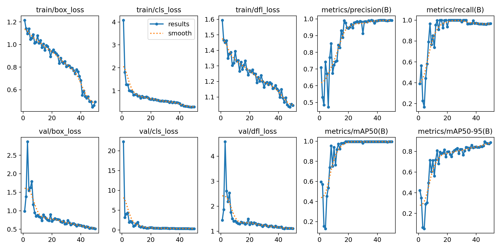
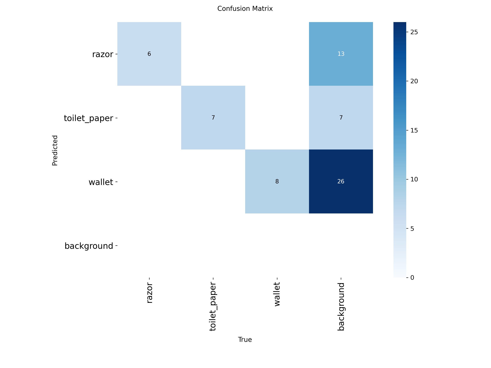

# YOLOv8 커스텀 객체 감지 및 추적

충북대학교 소프트웨어학부 기계학습 과제 — 전성현 (2022041053)

직접 촬영한 생활용품 3종(면도기, 두루마리 휴지, 지갑)으로 YOLOv8n을 전이학습했다. 학습한 모델로 동영상 속 물체를 감지하고, ByteTrack으로 추적하며 이동 궤적을 그렸다.

<a href="https://colab.research.google.com/github/whiteblack1858/yolo8-custum-traking/blob/main/yolov8.ipynb"></a>

## 추적 결과 (5초)

<!-- GitHub 웹 편집기에서 이 줄 아래에 tracking/track_result.mp4를 끌어다 놓으면 재생 플레이어가 생긴다 -->

[tracking/track_result.mp4](tracking/track_result.mp4)를 내려받아 볼 수도 있다. 노란 선은 각 객체 ID의 최근 60프레임 중심점 궤적이고, 프레임별 좌표는 [tracking/trajectory.csv](tracking/trajectory.csv)에 저장했다.

## 데이터

| 항목 | 내용 |
|---|---|
| 부류 | `razor` 면도기, `toilet_paper` 두루마리 휴지, `wallet` 지갑 |
| 원본 | 직접 촬영한 107장 |
| 라벨링 | Roboflow Auto Label → 수동 검수 |
| 분할 | train 228장(원본 76장 × 증강 3배) / valid 21장 / test 10장 |

자세한 내용은 [data/README.md](data/README.md)에 정리했다.

## 학습 설정

| 항목 | 값 |
|---|---|
| 모델 | YOLOv8n (COCO 사전학습 가중치, 3,133,193 파라미터) |
| epochs / patience | 50 / 20 |
| 이미지 크기 / batch | 640 / 16 |
| 환경 | Google Colab, Tesla T4, Ultralytics 8.4.216 |

## 성능

**검증 세트 (valid, 21장)**

| 부류 | Precision | Recall | mAP50 | mAP50-95 |
|---|---|---|---|---|
| 전체 | 0.990 | 0.961 | 0.995 | 0.898 |
| razor | 0.986 | 1.000 | 0.995 | 0.880 |
| toilet_paper | 0.984 | 1.000 | 0.995 | 0.926 |
| wallet | 1.000 | 0.884 | 0.995 | 0.889 |

**테스트 세트 (test, 10장)**

| 부류 | Precision | Recall | mAP50 | mAP50-95 |
|---|---|---|---|---|
| 전체 | 0.983 | 1.000 | 0.995 | 0.848 |
| razor | 0.982 | 1.000 | 0.995 | 0.995 |
| toilet_paper | 0.981 | 1.000 | 0.995 | 0.920 |
| wallet | 0.986 | 1.000 | 0.995 | 0.628 |




테스트 세트가 10장뿐이라 수치의 신뢰구간이 넓다. 특히 지갑의 mAP50-95(0.628)가 낮은데, 물체는 찾지만 박스 경계가 덜 정확하다는 뜻이다. 지갑은 펼친 상태와 접힌 상태에 따라 모양이 달라서 경계를 맞추기 어려웠던 것으로 보인다.

## 저장소 구조

```
yolo8-custum-traking/
├── README.md              과제 개요, 결과 요약
├── yolov8.ipynb           학습부터 추적까지 전 과정 (Colab 실행 기록 포함)
├── requirements.txt       재현용 패키지 목록
├── .gitignore
├── data/
│   ├── data.yaml          클래스 정의
│   └── README.md          수집·라벨링·분할 과정
├── weights/
│   └── best.pt            학습된 모델 (검증 mAP50-95 최고 시점)
├── results/
│   ├── train/             학습 곡선, 혼동 행렬, PR 곡선, 학습 설정(args.yaml), epoch별 기록(results.csv)
│   └── test/              테스트 세트 평가 결과
├── tracking/
│   ├── track_result.mp4   감지 + 추적 결과 영상 (5초)
│   └── trajectory.csv     프레임별 객체 ID·클래스·중심 좌표
└── scripts/
    ├── train.py           노트북 없이 학습 재현
    └── track.py           노트북 없이 추적 재현
```

## 재현 방법

```bash
pip install -r requirements.txt
python scripts/track.py --source 입력영상.mp4 --seconds 5      # 학습된 모델로 바로 추적
python scripts/train.py --data <Roboflow data.yaml 경로>        # 처음부터 다시 학습
```
